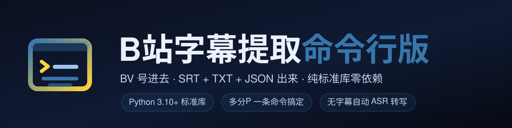

<p align="center">
  
</p>

# 🐍 B站字幕提取器 · 命令行版

> **BV 号进去，SRT + TXT + JSON 出来。**
> 有官方字幕直接下载，没有就下载音频走 ASR 语音转文字——**一条命令，可批量、可写进定时任务**。

[](https://github.com/huanweide/bili-subtitle-extractor/actions/workflows/ci.yml)
[](LICENSE)
[](https://www.python.org/)
[](tests/test_extractor.py)
[](https://github.com/huanweide/bili-subtitle-extractor)


**自动流程**：`BV 号 / URL → 拉视频信息与分P → 检测字幕 →（有）下载解析 →（无）下音频 → ASR 转写 → 落盘三件套`

[30 秒看懂](#30-秒看懂) · [它能做什么](#它能做什么) · [特性](#特性-features) · [快速开始](#快速开始-quick-start) · [CLI 速查](#cli-命令速查) · [架构](#架构-architecture) · [选哪个](#python-还是-js) · [路线图](#路线图-roadmap)

---

## 🎯 30 秒看懂

```text
之前 · 想拿一个 20 P 课程合集的文字稿
─────────────────────────────────────────────
  浏览器脚本   打开一页 → 点一下 → 复制 → 下一页 → 重复 20 次
  手写脚本     自己啃 B站 API、签名、分P cid、字幕 JSON → 一下午

之后 · 一条命令
─────────────────────────────────────────────
$ python bili_subtitle_extractor.py BV1xx411c7mD --page all

[1/5] 获取视频信息...
  标题: 【公开课】...
  UP主: XXX  |  分P数: 20
── 第 1P: 第 1 讲 (cid=123456) ──
[2/5] 检测字幕...
  发现字幕 (中文（简体）)，直接提取
[5/5] 保存字幕...
  ✓ 保存到: output/BV1xx411c7mD_p1_第 1 讲
==================================================
完成! 共处理 20 个分P

$ ls output/BV1xx411c7mD_p1_第\ 1\ 讲/
subtitle.srt   subtitle.txt   metadata.json
```

**一句话差别**：浏览器脚本解决「随手点一下」，本项目解决「一次拿一堆、还要能写进脚本」。

---

## 它能做什么

**场景 1 · 单个视频，有官方字幕**

```
User: python bili_subtitle_extractor.py BV1xx411c7mD
  → 拉视频信息（标题 / UP主 / 分P cid）
  → 检测字幕轨道：AI 中文字幕 > 中文（自动生成）> 中文（手动）> 任意字幕
  → 下载字幕 JSON → 用原始时间戳生成 SRT + 纯文本 TXT
  → 落盘 output/{BV}_p{页}_{标题}/ 三件套
```

**场景 2 · 无字幕视频，走 ASR**

```
User: python bili_subtitle_extractor.py BV1xx411c7mD --asr-key sk-xxx
  → 检测字幕：无
  → 从 DASH 接口取最低码率音频流（ASR 不需要高音质，省时省流量）
  → 直链下载（支持断点续传）/ 或 --use-yt-dlp 兜底
  → 送硅基流动 SenseVoiceSmall 转写 → 按中文标点断句 → SRT + TXT
  → 清掉临时音频
```

**场景 3 · 先看看有什么，再决定下不下**

```
User: python bili_subtitle_extractor.py BV1xx411c7mD --list
  → 标题 / UP主 / 分P数
  → 每个分P列出可用字幕语言，或明确写「无 → 需要 ASR」
```

---

## 特性 / Features

- **零依赖内核 (stdlib-only)** — 核心链路只用 Python 3.10+ 标准库，**不用 `pip install` 任何东西就能跑**；`yt-dlp` 只是可选增强（`--use-yt-dlp`）。
- **三件套落盘 (SRT + TXT + JSON)** — SRT 带原始时间戳可直接挂播放器，TXT 是纯文本方便喂给 AI，JSON 存 BV/aid/cid/UP主/来源等元信息便于后续脚本消费。
- **字幕择优闸门 (find_best_subtitle)** — AI 中文字幕 → 中文（自动生成）→ 中文（手动）→ 任意字幕，按优先级挑，不是抓到第一条就用。
- **全分P批处理 (`--page all`)** — 一条命令跑完整个合集；单 P 越界会明确报「页码 N 超出范围 (1-M)」，不静默下错。
- **音频取最低码率 (bandwidth-min)** — ASR 不需要高音质，自动挑 DASH 里带宽最低的音轨，省时间省流量。
- **直链下载带断点续传 (Range)** — 复用已下载部分；服务端不支持 Range 返回 200 时从头覆盖，不会写出半截拼接的坏文件。
- **本地缓存层 (Cache)** — 视频信息缓存 24 小时（`CACHE_TTL`），重复跑不重复请求；缓存文件损坏或过期会当成未命中，不会把脏数据当结果。
- **代理与 SSL 可控** — `--proxy` 对所有下载与 API 请求生效（不只是 yt-dlp）；`--no-ssl-verify` 留给被迫的中间人环境，默认仍是校验开启。

---

## 快速开始 / Quick Start

### 安装

```bash
git clone https://github.com/huanweide/bili-subtitle-extractor.git
cd bili-subtitle-extractor
# 核心功能无需 pip install；只有音频兜底下载才需要 yt-dlp：
pip install yt-dlp          # 可选
```

### 一条命令跑起来

```bash
python bili_subtitle_extractor.py BV1xx411c7mD
# 也可以直接贴 URL
python bili_subtitle_extractor.py https://www.bilibili.com/video/BV1xx411c7mD
```

示例输出（取自脚本真实打印）：

```text
[1/5] 获取视频信息...
  标题: 示例视频标题
  UP主: 示例UP  |  分P数: 3
── 第 1P: 第一部分 (cid=111111) ──
[2/5] 检测字幕...
  发现字幕 (中文（简体）)，直接提取
[5/5] 保存字幕...
  ✓ 保存到: output/BV1xx411c7mD_p1_第一部分

==================================================
完成! 共处理 1 个分P
  output/BV1xx411c7mD_p1_第一部分
```

### 无字幕时配 ASR Key

```bash
export SILICONFLOW_API_KEY="sk-xxx"        # Linux / macOS
$env:SILICONFLOW_API_KEY="sk-xxx"          # Windows PowerShell
python bili_subtitle_extractor.py BV1xx411c7mD --asr-key sk-xxx   # 也可直接传参
```

> ⚠️ Key 只走环境变量或命令行参数，**不要写进仓库文件**。无字幕且没给 Key 时，脚本会明确报错而不是默默跳过。

### 自测

```bash
python tests/test_extractor.py      # 33 条断言，不联网
python bili_subtitle_extractor.py --version
```

```text
Ran 33 tests in 0.16s
OK
bili-subtitle-extractor 1.0.0
```

---

## CLI 命令速查

| 参数 | 说明 | 默认 |
|---|---|---|
| `bvid` | BV 号或包含 BV 号的 URL（必填） | — |
| `-o, --output-dir` | 输出目录 | `./output` |
| `-p, --page` | 分P页码，`all` 为全部 | `1` |
| `--asr-key` | 硅基流动 API Key | 环境变量 `SILICONFLOW_API_KEY` |
| `--asr-model` | ASR 模型 | `FunAudioLLM/SenseVoiceSmall` |
| `--use-yt-dlp` | 用 yt-dlp 下载音频（兜底，需自行安装） | 关 |
| `--proxy` | HTTP 代理（对所有请求生效） | 环境变量 `BILI_PROXY` |
| `--no-ssl-verify` | 跳过 SSL 验证（不推荐） | 关 |
| `--list` | 仅预览视频信息与可用字幕，不提取 | 关 |
| `--cache-dir` | 缓存目录 | `./output/.cache` |
| `-V, --version` | 打印版本 | — |

---

## 架构 / Architecture

**一句话**：一条**五步直线流水线**（取信息 → 检测 → 取源 → 转写 → 落盘），中间只在「有没有字幕」这个分叉上做一次选择；长视频不靠内存扛，靠**最低码率音频 + 断点续传下载**把成本压下来。

### 概念表 / Primitives

| 概念 | 含义 |
|---|---|
| BV 号抽取 (extract_bvid) | 从纯 BV 号或完整 URL 里正则取出 BV 号，取不到就报错退出 |
| 分P列表 (pages) | 每个分P有自己的 cid，字幕与音频都按 cid 定位；`all` 即遍历 |
| 字幕择优 (find_best_subtitle) | AI 中文 > 中文自动 > 中文手动 > 任意 |
| 原始时间戳 (body_to_srt) | 官方字幕带真实 from/to，直接转 SRT，不做估算 |
| 估算时间戳 (asr_text_to_srt) | ASR 只有纯文本，按中文标点断句后估算时间，**明确标注为估算** |
| 缓存 (Cache) | 24 小时 TTL 的 JSON 文件缓存，损坏即视为未命中 |
| 音频取最低码率 (fetch_audio_url) | DASH 音轨里挑 bandwidth 最小的，够 ASR 用就行 |

### 主流程

```text
输入 BV 号 / URL
   │
   ├─ extract_bvid（取不到 → 报错退出 1）
   │
   ├─ fetch_video_info ─► 标题 / UP主 / 分P + cid
   │
   ├─ 缓存命中？ ── 是 ─► 直接复用，跳过网络请求
   │
   └─ 否 ─► 逐分P处理
          [2/5] fetch_subtitle_list（按 cid）
                 │
                 ├─ 有字幕 ─► find_best_subtitle → 下载 JSON → body_to_srt（真实时间戳）
                 │
                 └─ 无字幕 ─► [3/5] 下音频
                                 ├─ --use-yt-dlp → download_audio_ytdlp
                                 └─ 默认 → fetch_audio_url（最低码率）→ download_audio_direct（断点续传）
                              [4/5] transcribe_siliconflow（multipart 上传）→ asr_text_to_srt（估算时间戳）
                              清理临时音频
          [5/5] save_output ─► subtitle.srt + subtitle.txt + metadata.json
                              └─ 写回缓存
```

### 核心模块 / Core Modules

| 模块 | 位置 | 职责 |
|---|---|---|
| CLI 入口 | `bili_subtitle_extractor.py` · `main()` | 参数解析、BV 号校验、`--list` 预览、异常收敛为退出码 1 |
| 主流程 | `bili_subtitle_extractor.py` · `extract_subtitle()` | 五步流水线与分P循环 |
| B站 API | `fetch_video_info` / `fetch_subtitle_list` / `fetch_audio_url` | 视频信息、字幕轨道、DASH 音轨 |
| 下载 | `download_audio_direct` / `download_audio_ytdlp` | 直链断点续传 / yt-dlp 兜底 |
| ASR | `transcribe_siliconflow` | multipart 上传音频，返回转写文本 |
| 格式化 | `body_to_srt` / `asr_text_to_srt` / `fmt_srt_time` | 字幕 body 与 ASR 文本 → SRT + TXT |
| 缓存 | `Cache` | 24h JSON 缓存，损坏容错 |
| 工具 | `extract_bvid` / `safe_filename` / `build_ssl_context` | BV 号抽取、文件名消毒、SSL 上下文 |
| 测试 | `tests/test_extractor.py` | 33 条断言，纯函数层，不联网 |

---

## 加一个你自己的出口格式

输出三件套都在 `save_output()` 里，加一种格式只需加一段写文件：

```python
def save_output(output_dir, bvid, title, page_num, srt_content, txt_content, metadata):
    safe = safe_filename(title)
    folder = os.path.join(output_dir, f"{bvid}_p{page_num}_{safe}")
    os.makedirs(folder, exist_ok=True)
    # 新增：顺手写一份 Markdown，方便丢进笔记软件
    with open(os.path.join(folder, "subtitle.md"), "w", encoding="utf-8") as f:
        f.write(f"# {title}\n\n{txt_content}\n")
    ...
```

改完记得在 `tests/test_extractor.py` 里补一条断言——纯函数层改动都有测试兜底。

---

## Python 还是 JS

同一作者维护两个 B 站字幕项目，**定位不重叠，别选错**：

| | **本仓库 · bili-subtitle-extractor**（Python CLI） | [bili-subtitle-universal](https://github.com/huanweide/bili-subtitle-universal)（油猴脚本） |
|---|---|---|
| 形态 | 终端一条命令 | 浏览器里点一下 |
| 覆盖 | 专注 B 站 | **B站 + YouTube + 任意网页 `<video>`** |
| 批量 | **`--page all` 一次跑完整合集** | 单次当前页面 |
| 依赖 | **Python 3.10+ 标准库** | Tampermonkey + 浏览器 |
| 自动化 | **可写进脚本 / 定时任务 / CI** | 需人工在页面操作 |
| 无字幕 | 下载音频 → 硅基流动 ASR | 分段解码 → ASR（含断点续传） |

> **如果你要「在浏览器里点一下就提取」，还要覆盖 YouTube / 任意网页——请用 [bili-subtitle-universal](https://github.com/huanweide/bili-subtitle-universal)。**
> **如果你要「批量、离线、能写进脚本」——请用本仓库。**

---

## 安全边界

- **不内置任何 Key**：ASR Key 只从环境变量或 `--asr-key` 读取，仓库里不含任何密钥。
- **只取你有权观看的内容**：本项目不绕权限、不破解付费内容。
- **网络行为可审计**：只请求 B站官方接口与你指定的 ASR 端点；`--proxy` 让你自己掌握出口。
- **不偷偷花你的钱**：只有「无字幕且你给了 Key」才会调用 ASR。
- **输出仅作个人学习与无障碍辅助**，请遵守《著作权法》与 B 站相关规则。

---

## 路线图 / Roadmap

- ✅ BV 号 / URL 输入、字幕择优、多分P `--page all`
- ✅ 无字幕 → 音频 → ASR 转写、直链断点续传、yt-dlp 兜底
- ✅ 24h 本地缓存、`--list` 预览、代理与 SSL 开关
- ✅ 零依赖单元测试 33 条（`tests/test_extractor.py`）
- ⬜ 多语言字幕轨道选择（当前择优规则偏向中文）
- ⬜ 输出格式扩展：VTT / Markdown
- ⬜ 批量 BV 号清单输入（文件 / stdin）
- ⬜ ASR 厂商可切换（当前仅硅基流动）

想要哪个，欢迎在 [Issues](https://github.com/huanweide/bili-subtitle-extractor/issues) 里说一声。

---

## 贡献 / Contributing

1. Fork → 建分支 → 改代码
2. `python tests/test_extractor.py` 必须全绿（33 条断言，不联网）
3. 新增纯函数请同步补测试；联网逻辑请保持在 CLI 层，不要污染纯函数层
4. 提 PR 时说明你验证过的真实 BV 号与命令（**不要贴 Key**）

CI（`ci.yml`）在 Python 3.12 / 3.13 上跑：语法检查 + 单元测试 + CLI 冒烟；`ruff` 仅作提示，不阻断。

---

## License

MIT — 详见 [LICENSE](LICENSE)。B 站相关名称归其各自所有者。

---

## Star

如果这个工具帮你省下了一次手动扒字幕的时间，**点个 Star 就是最好的回报**。

**作者**：huanweide（[@huanweide](https://github.com/huanweide)）· MIT

**同一作者的其他工具**：

- 🎬 [bili-subtitle-universal](https://github.com/huanweide/bili-subtitle-universal) · 全网视频字幕提取（浏览器点一下，含 YouTube）
- 🔴 [live-subtitle](https://github.com/huanweide/live-subtitle) · 直播 / 会议实时中文字幕（本地识别）
- 🎓 [zhihuishu-helper](https://github.com/huanweide/zhihuishu-helper) · 智慧树网课自动播放 / 断点续播
- 🩺 [family-showcase](https://github.com/huanweide/family-showcase) · 代码健康工具总览
- 📦 [全部仓库](https://github.com/huanweide?tab=repositories)
